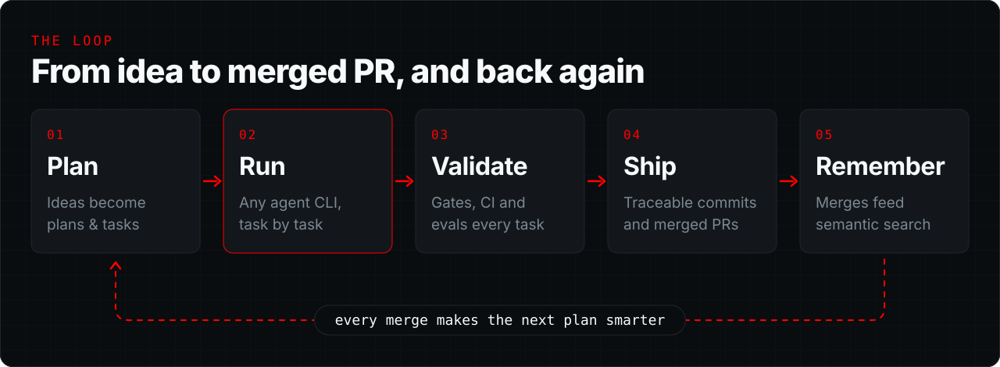
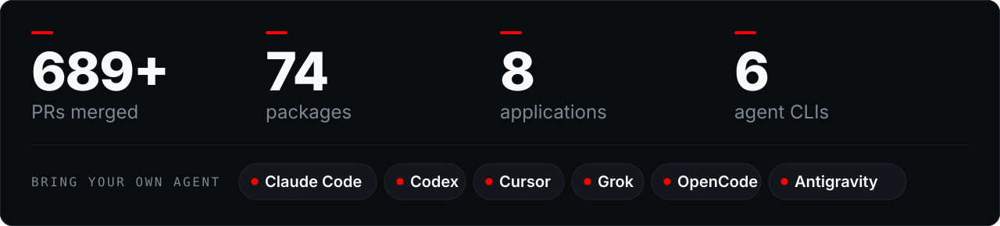

<!-- Generated by `pnpm nx run @openthrottle/openthrottle-product:generate-surfaces` from packages/openthrottle-product. Do not edit by hand. -->

<p align="center">
  <a href="https://openthrottle.ai">
    <picture>
      <source media="(prefers-color-scheme: dark)" srcset="./assets/hero-dark.svg">
      <source media="(prefers-color-scheme: light)" srcset="./assets/hero-light.svg">
      
    </picture>
  </a>
</p>

<p align="center">
  <a href="https://openthrottle.ai"></a>
  <a href="https://github.com/OpenThrottle/monorepo"></a>
  <a href="https://github.com/OpenThrottle/monorepo/actions/workflows/continuous-integration.yml"></a>
  <a href="https://github.com/OpenThrottle/monorepo/blob/main/LICENSE.md"></a>
</p>

**OpenThrottle is the AI-native platform for planning and shipping software: plans, agent runs and commits in one system you own.** Chat tabs forget, Markdown plans drift, and issue trackers never see the agent run. OpenThrottle keeps intent, execution and outcome together. Write a plan, hand it to any agent CLI through a runner you can customize, and get back commits that point to the task that produced them. Everything runs locally on open-source software, and everything that happens becomes memory the next run can use.

<p align="center">
  <picture>
    <source media="(prefers-color-scheme: dark)" srcset="./assets/loop-dark.svg">
    <source media="(prefers-color-scheme: light)" srcset="./assets/loop-light.svg">
    
  </picture>
</p>

## 🏁 What's under the hood

<table>
  <tr>
    <td width="33%" valign="top">
      <h3>📋 Plans and tasks</h3>
      Durable plans and tasks with a real lifecycle, not Markdown files that drift.
    </td>
    <td width="33%" valign="top">
      <h3>🧠 Knowledge search</h3>
      Hybrid search over plans, tasks, notes and repo docs, grounded in what your team shipped.
    </td>
    <td width="33%" valign="top">
      <h3>🔌 MCP in every agent CLI</h3>
      One MCP server for Claude Code, Cursor, Codex, OpenCode and Antigravity, with the same permissions in each.
    </td>
  </tr>
  <tr>
    <td width="33%" valign="top">
      <h3>🧩 Shared skills</h3>
      Skills, rules and prompts in one place, shared with every agent tool and promoted when they are ready.
    </td>
    <td width="33%" valign="top">
      <h3>🔁 Customizable runners</h3>
      Foundational runners and loops that work a plan task by task, ready for you to adapt and improve.
    </td>
    <td width="33%" valign="top">
      <h3>🤖 Any agent CLI</h3>
      Run plans with Claude Code, Codex, Cursor, OpenCode, Antigravity or Grok.
    </td>
  </tr>
  <tr>
    <td width="33%" valign="top">
      <h3>🌳 Worktree isolation</h3>
      Each run gets its own worktree, ports and database, so parallel agents never collide.
    </td>
    <td width="33%" valign="top">
      <h3>🗓️ Queued and scheduled runs</h3>
      Run a plan now or schedule it, with guards that stop it running late or running twice.
    </td>
    <td width="33%" valign="top">
      <h3>🕹️ Steer a live run</h3>
      Message a running plan mid-task and redirect it without starting over.
    </td>
  </tr>
  <tr>
    <td width="33%" valign="top">
      <h3>🏗️ Generators</h3>
      Scaffold code in the shape your codebase expects, so agents produce predictable output.
    </td>
    <td width="33%" valign="top">
      <h3>📒 Work ledger</h3>
      Every commit points back to the plan and task that produced it, on a ledger you can query.
    </td>
    <td width="33%" valign="top">
      <h3>📊 Attributed token usage</h3>
      Token usage from every agent CLI, attributed to the model, the task and the billed account.
    </td>
  </tr>
  <tr>
    <td width="33%" valign="top">
      <h3>🧪 Evals <sub><code>preview</code></sub></h3>
      Evals built from real runs: datasets from failures, calibrated graders, paired comparisons.
    </td>
    <td width="33%" valign="top">
      <h3>🖥️ Developer app</h3>
      A dashboard for plans, queues, pull requests, schedules and usage, plus a timeline of the work.
    </td>
    <td width="33%" valign="top">
      <h3>🏠 Runs entirely local</h3>
      The whole stack, embeddings included, runs on your machine. Cloud providers are optional.
    </td>
  </tr>
  <tr>
    <td width="33%" valign="top">
      <h3>💻 Desktop app</h3>
      A native desktop shell around the developer app.
    </td>
    <td width="33%" valign="top"></td>
    <td width="33%" valign="top"></td>
  </tr>
</table>

<p align="center">
  <picture>
    <source media="(prefers-color-scheme: dark)" srcset="./assets/stats-dark.svg">
    <source media="(prefers-color-scheme: light)" srcset="./assets/stats-light.svg">
    
  </picture>
</p>

## 🔧 In the garage

History is not only a record. Evals are built from real runs, and a scheduled job proposes updates from what landed, so each iteration of the system improves the next.

- **Content CMS.** Schema-driven editing of fragments and layouts, with nested previews and drag-to-reorder.
- **Agent-agnostic loop job.** A background loop job that drives any agent CLI with the same validation and settling.
- **Skill-usage telemetry.** See which agent skills get used, how they turn out and where coverage is thin.
- **Cross-repo projects.** Ordered initiatives that span repositories, planned and tracked as one piece of work.
- **Specialist roles and critics.** Specialist agent roles and parallel critics that review each task before it lands.
- **Standalone install.** One download that bundles the whole stack with the desktop app.
- **Signed desktop releases.** A signed, notarized desktop app that updates itself.
- **Phone access.** Reach your own OpenThrottle from your phone, with agent runs gated behind a passkey.

## 🚦 Project status

| Project | Status | What it is |
| --- | --- | --- |
| `openthrottle-server` | ✅ Stable | NestJS code-first GraphQL API: the backbone of the platform. |
| `openthrottle-developer` | ✅ Stable | The flagship developer portal for plans, projects, queues and PRs. |
| `openthrottle-mcp` | ✅ Stable | The MCP server that brings OT into every editor and agent. |
| `openthrottle` | ✅ Stable | Quick start: the `docker compose up` entrypoint. |
| `openthrottle-website` | ✅ Stable | [openthrottle.ai](https://openthrottle.ai). |
| `openthrottle-app` | 🚧 Experimental | Electron desktop shell. |
| `openthrottle-cms` | 🚧 Experimental | Content management for OpenThrottle sites. |
| `openthrottle-admin` | 🧭 Planned | Team management, roles and permissions. |

## ⚡ Zero to sixty

```bash
git clone https://github.com/OpenThrottle/monorepo.git && cd monorepo
nvm use && ./scripts/setup.sh   # Postgres, Redis, migrations, a seeded login
pnpm run start                  # API on :6021, developer app on :6020
```

Then point your agent at `openthrottle-mcp` and ask it what's in progress. The [local quickstart](https://github.com/OpenThrottle/monorepo/blob/main/docs/openthrottle/local-quickstart.md) walks through it end to end.

<details>
<summary><b>🛠️ Built with</b></summary>
<br>

TypeScript end to end in an Nx + pnpm monorepo: **NestJS** and **Apollo GraphQL** on the server, **React Router** + **Vite** + **Tailwind** + **shadcn/ui** on the client, **Postgres** + **pgvector** for data and search, **Redis** + **BullMQ** for queues, and **Electron** for desktop.

</details>

## 🤝 Open source

OpenThrottle is **open core**. The core is licensed under the **Apache License, Version 2.0**, and commercial/enterprise modules are reserved under a separate EULA. The **OpenThrottle** name and logo are trademarks (Apache-2.0 §6 grants no trademark rights). You can build on the code freely; use of the marks is covered by our trademark policy.

Want to help? Start with [CONTRIBUTING](https://github.com/OpenThrottle/.github/blob/main/CONTRIBUTING.md), find help in [SUPPORT](https://github.com/OpenThrottle/.github/blob/main/SUPPORT.md), and report vulnerabilities privately via [SECURITY](https://github.com/OpenThrottle/.github/blob/main/SECURITY.md).

<p align="center"><sub>Built with ❤️ and a heavy right foot.</sub></p>
