<p align="center">
  <a href="https://openthrottle.ai">
    <picture>
      <source media="(prefers-color-scheme: dark)" srcset="./assets/hero-dark.svg">
      <source media="(prefers-color-scheme: light)" srcset="./assets/hero-light.svg">
      
    </picture>
  </a>
</p>

<p align="center">
  <a href="https://openthrottle.ai"></a>
  <a href="https://github.com/OpenThrottle/monorepo"></a>
  <a href="https://github.com/OpenThrottle/monorepo/actions/workflows/continuous-integration.yml"></a>
  <a href="https://github.com/OpenThrottle/monorepo/blob/main/LICENSE.md"></a>
</p>

**OpenThrottle is context-driven AI for developers.** Your plans, tasks and knowledge live in one Postgres-backed brain that your editor, your agents and your team all share over MCP. Hand a plan to any agent CLI, and OpenThrottle runs it a task at a time in an isolated worktree, validates every step, and lands traceable commits. Every merge feeds back into the knowledge base, so the next plan starts smarter than the last.

<p align="center">
  <picture>
    <source media="(prefers-color-scheme: dark)" srcset="./assets/loop-dark.svg">
    <source media="(prefers-color-scheme: light)" srcset="./assets/loop-light.svg">
    
  </picture>
</p>

## 🏁 What's under the hood

<table>
  <tr>
    <td width="33%" valign="top">
      <h3>🧠 Plans knowledge base</h3>
      Plans, tasks, notes and your repo docs in Postgres + pgvector. Ask OT a question in plain language and get answers grounded in what your team actually planned and shipped.
    </td>
    <td width="33%" valign="top">
      <h3>🔌 MCP-native</h3>
      <code>openthrottle-mcp</code> puts the whole knowledge base inside Claude Code, Cursor, Codex and friends, with the same servers and permissions in every tool.
    </td>
    <td width="33%" valign="top">
      <h3>🔁 OT Loop &amp; Ralph</h3>
      Two plan runners that work one task at a time: select, work, validate, commit. Each commit carries a <code>Plan-Id</code> and <code>Task-Id</code>, and you can message a run mid-task.
    </td>
  </tr>
  <tr>
    <td width="33%" valign="top">
      <h3>🌳 Worktree isolation</h3>
      Every run gets its own git worktree, its own ports and, when it needs one, its own database. Parallel agents stay out of each other's way.
    </td>
    <td width="33%" valign="top">
      <h3>🗓️ Queued &amp; scheduled runs</h3>
      BullMQ-backed runs you can start now or schedule up to 30 days out. Grace windows and collision holds keep a plan from running late or running twice.
    </td>
    <td width="33%" valign="top">
      <h3>🧪 Evals <sub><code>preview</code></sub></h3>
      Every run is recorded as an open ATIF trajectory. Build datasets from real failures, then compare models, drivers and prompts with pass@k, bootstrap CIs and McNemar tests.
    </td>
  </tr>
  <tr>
    <td width="33%" valign="top">
      <h3>📊 Token usage, attributed</h3>
      Usage from every agent CLI is normalized into one shape and attributed to the model, the task and the account that was billed.
    </td>
    <td width="33%" valign="top">
      <h3>🖥️ Developer app</h3>
      A dashboard for plans, queues, pull requests, timeline and code search, with a desktop shell on the way.
    </td>
    <td width="33%" valign="top">
      <h3>🏠 Runs entirely local</h3>
      Postgres, Redis and Ollama on your own machine. No SaaS is required for the core flows and there's no vendor lock-in. Cloud embeddings are optional.
    </td>
  </tr>
</table>

<p align="center">
  <picture>
    <source media="(prefers-color-scheme: dark)" srcset="./assets/stats-dark.svg">
    <source media="(prefers-color-scheme: light)" srcset="./assets/stats-light.svg">
    
  </picture>
</p>

## 🔥 In the kitchen

We build in the open, so here's what's on the stove right now:

- **Content CMS.** Schema-driven fragment and layout editing, with nested previews and drag-to-reorder.
- **Skill-usage telemetry.** See which agent skills get used, how they turn out, and where coverage is thin. It's privacy-first and fail-open.
- **Plan inbox.** Steer a running plan by sending messages that land mid-task, before any destructive step.
- **Admin & rollout.** Users, roles and RBAC-aware feature flags for teams.
- **Desktop app.** An Electron shell around the developer app, with deep links and native folder picking.
- **0–60.** Short screencasts of the real app, scripted and produced by our own pipeline.

## 🚦 Project status

| Project                  | Status          | What it is                                                         |
| ------------------------ | --------------- | ------------------------------------------------------------------ |
| `openthrottle-server`    | ✅ Stable       | NestJS code-first GraphQL API: the backbone of the platform.       |
| `openthrottle-developer` | ✅ Stable       | The flagship developer portal for plans, projects, queues and PRs. |
| `openthrottle-mcp`       | ✅ Stable       | The MCP server that brings OT into every editor and agent.         |
| `openthrottle`           | ✅ Stable       | Quick start: the `docker compose up` entrypoint.                   |
| `openthrottle-website`   | ✅ Stable       | [openthrottle.ai](https://openthrottle.ai).                        |
| `openthrottle-app`       | 🚧 Experimental | Electron desktop shell.                                            |
| `openthrottle-cms`       | 🚧 Experimental | Content management for OpenThrottle sites.                         |
| `openthrottle-admin`     | 🧭 Planned      | Team management, roles and permissions.                            |

## ⚡ Zero to sixty

```bash
git clone https://github.com/OpenThrottle/monorepo.git && cd monorepo
nvm use && ./scripts/setup.sh   # Postgres, Redis, migrations, a seeded login
pnpm run start                  # API on :6021, developer app on :6020
```

Then point your agent at `openthrottle-mcp` and ask it what's in progress. The [local quickstart](https://github.com/OpenThrottle/monorepo/blob/main/docs/openthrottle/local-quickstart.md) walks through it end to end.

<details>
<summary><b>🛠️ Built with</b></summary>
<br>

TypeScript end to end in an Nx + pnpm monorepo: **NestJS** and **Apollo GraphQL** on the server, **React Router** + **Vite** + **Tailwind** + **shadcn/ui** on the client, **Postgres** + **pgvector** for data and semantic search, **Redis** + **BullMQ** for queues, **Electron** for desktop and **Ollama** for local models.

</details>

## 🤝 Open source

OpenThrottle is **open core**. The core is licensed under the **Apache License, Version 2.0**, and commercial/enterprise modules are reserved under a separate EULA. The **OpenThrottle** name and logo are trademarks (Apache-2.0 §6 grants no trademark rights). You can build on the code freely; use of the marks is covered by our trademark policy.

Want to help? Start with [CONTRIBUTING](https://github.com/OpenThrottle/.github/blob/main/CONTRIBUTING.md), find help in [SUPPORT](https://github.com/OpenThrottle/.github/blob/main/SUPPORT.md), and report vulnerabilities privately via [SECURITY](https://github.com/OpenThrottle/.github/blob/main/SECURITY.md).

<p align="center"><sub>Built with ❤️ and a heavy right foot.</sub></p>
